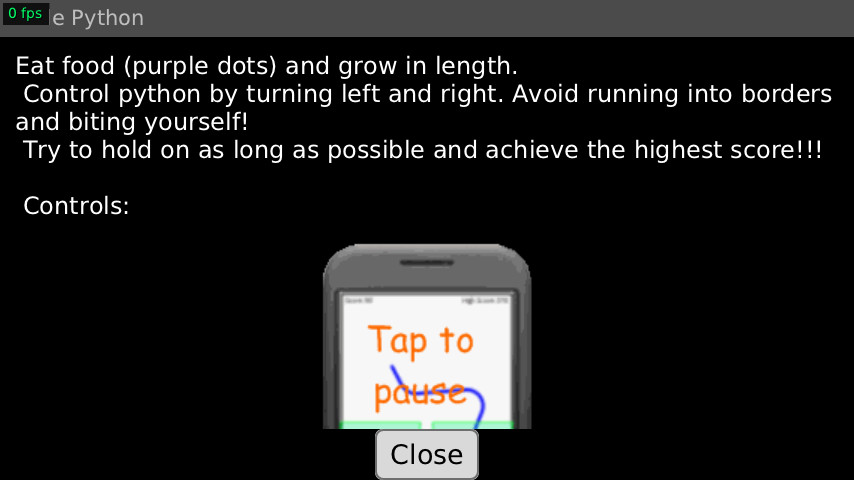

# Terminator

Android recompilation for the Wii U.
## Note about source code
Source code and builds will not be published yet until Terminator is in a decent state. We will go under a testing period eventually.
## Roadmap
Native ARM games (or ones using OpenGL) are not supported yet
* Android 1.x (Petit Four, Cupcake, Donut) - started
* Android 2.x (Eclair, Froyo, Gingerbread) - started (ARM/x86 games planned)
* Android 3.x (Honeycomb) - planned
* Android 4.x (Ice Cream Sandwich, Jelly Bean, KitKat) - planned
* Android 5.x (Lollipop) - considered (Dalvik support is removed in this version; 64-bit applications: never)
* Android 6.x (Marshmellow) - considered (Dalvik support is removed in this version; 64-bit applications: never)
* Android 7.x (Nougat) and later - never 
